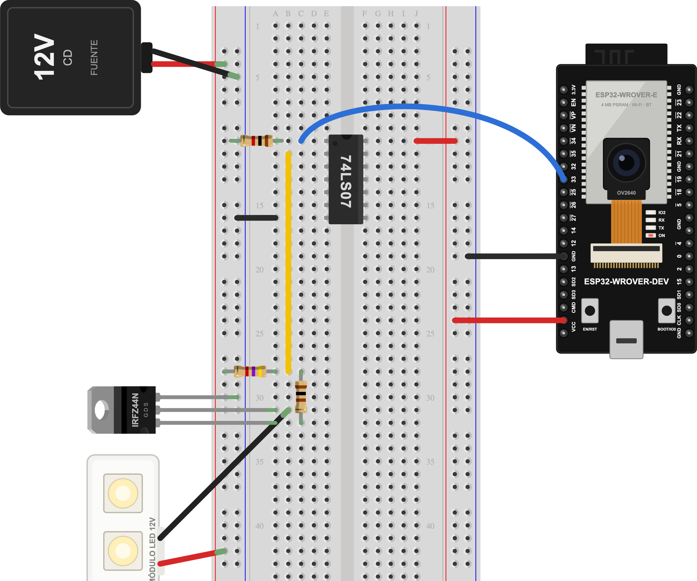

# ESP32-CAM + MOSFET por gestos (74LS07 + IRFZ44N)

Proyecto demostrativo de **Tostatronic** — Ing. Jorge Alvarado.

Le enseñas el **pulgar arriba** a la cámara y un módulo LED de 12 V se enciende.
Con la **señal de paz** (✌️), se apaga. La ESP32-WROVER-CAM manda el video por WiFi a
un programa en Python que reconoce la seña con MediaPipe y le contesta a la placa
cuál debe ser el estado del LED.

Responde una pregunta que nos hicieron mucho: *¿se puede activar un MOSFET con
un ESP32 usando la 74LS07?* Sí.



---

## Por qué hace falta la 74LS07

El **IRFZ44N** es un MOSFET canal N, pero **no es de nivel lógico**:

| IRFZ44N (hoja de datos de IR/Infineon) | |
|---|---|
| VDSS | 55 V |
| ID continua (25 °C, VGS = 10 V) | 49 A |
| RDS(on) máx. | 17.5 mΩ **con VGS = 10 V** |
| VGS(th) | 2.0 a 4.0 V |
| VGS máx. | ±20 V |

Empieza a conducir entre 2 y 4 V, pero rinde completo hasta los 10 V. Con los
3.3 V de un GPIO del ESP32 se queda a medias: o no enciende, o se calienta.

La **74LS07** tiene salida de **colector abierto** que aguanta hasta **30 V**. Su
entrada TTL toma como «1» cualquier voltaje desde 2 V, así que los 3.3 V del ESP32
le alcanzan. Con una resistencia pull-up a 12 V, la compuerta del MOSFET recibe
12 V y el MOSFET enciende por completo. Además, la 74LS07 no invierte: GPIO en 1
→ LED encendido.

> Existe una versión de nivel lógico, el **IRLZ44N** (umbral de 1 a 2 V, 25 mΩ
> a 5 V). Esa la vemos en otro proyecto.

---

## Materiales

- ESP32-WROVER-DEV con cámara OV2640
- Circuito integrado 74LS07
- MOSFET IRFZ44N
- Módulo LED de 12 V
- Fuente de 12 V CD (con adaptador de jack a bornera)
- Resistencias: 1 kΩ, 4.7 kΩ y 100 Ω
- Protoboard y jumpers

Todo lo encuentras en [tostatronic.com](https://www.tostatronic.com).

---

## Conexiones

En el diagrama, los rieles de la izquierda son **12 V** y los de la derecha son
**5 V**. El circuito completo está en `diagrama/ESP32_CAM_MOSFET.fzz` (Fritzing
1.0, con las piezas incluidas).

| # | Conexión | Por qué |
|---|---|---|
| 1 | VCC (5 V) del ESP32 → riel +5 V | Alimenta la 74LS07. |
| 2 | GND del ESP32 → riel GND | Referencia del lado lógico. |
| 3 | Fuente: + → riel +12 V, − → riel GND | Potencia para el LED y la compuerta. |
| 4 | **GND de 12 V ↔ GND de 5 V** | Sin tierra común, la señal no tiene referencia. |
| 5 | IRFZ44N: **S → GND**, D → LED (−), G → nodo de compuerta | El MOSFET cierra el negativo del LED. |
| 6 | 74LS07: pin 14 → +5 V, pin 7 → GND | Se alimenta a 5 V (TTL). |
| 7 | **1 kΩ** del pin 1 (1A) a GND | Una entrada TTL al aire se lee como 1. Así el LED no prende solo al arrancar. |
| 8 | **4.7 kΩ** del pin 2 (1Y) a +12 V | Pull-up: cuando la salida «suelta», la compuerta sube a 12 V. |
| 9 | **100 Ω** del pin 2 (1Y) a la compuerta | Limita el pico de corriente al cargar la compuerta. |
| 10 | Módulo LED: + → +12 V, − → drain | La carga. |
| 11 | **GPIO33** del ESP32 → pin 1 (1A) | La orden: 1 enciende, 0 apaga. |

**Notas:**

- **GPIO33 está libre** aunque la cámara esté activa. La OV2640 ocupa 4, 5, 18,
  19, 21, 22, 23, 25, 26, 27, 34, 35, 36 y 39.
- **Pull-up de 4.7 kΩ y no de 1 kΩ:** mientras el LED está apagado, el pull-up
  consume. Con 1 kΩ serían 144 mW; con 4.7 kΩ son 31 mW.
- **Conecta los 12 V al final y desconéctalos primero.** Si la 74LS07 se queda
  sin 5 V, el pull-up deja la compuerta en 12 V y el LED prende.
- **Verifica con multímetro el pin VCC del ESP32** (unos 5 V con el USB conectado)
  antes de conectarlo al riel.
- **Solo corriente directa:** un MOSFET no conmuta un foco de 127 V CA.

---

## 1. Programa de la ESP32 (`ESP32_CAM_MOSFET/`)

Es el mismo portal cautivo de [ESP32_WROVER_CAM](../ESP32_WROVER_CAM/), con el
control de la carga agregado.

**Arduino IDE:**

| | |
|---|---|
| Placa | ESP32 Wrover Module |
| Partition Scheme | Huge APP (3MB No OTA/1MB SPIFFS) |
| Core | esp32 de Espressif 3.x |

No necesitas instalar librerías: todo viene en el core.

**Primer arranque:**
1. Conéctate a la red WiFi **Tostatronic-CAM**. El portal se abre solo; ahí
   eliges tu red y escribes la clave.
2. La placa se reinicia en modo cámara. Su IP aparece en el portal y en el
   monitor serie (115200). También responde en `http://tostacam.local`.
3. En la página de la cámara hay botones **Encender / Apagar** para probar el
   circuito sin Python.

**API (puerto 80):**

| Ruta | Qué hace |
|---|---|
| `/carga?estado=1` | Enciende (GPIO33 en 1) |
| `/carga?estado=0` | Apaga |
| `/carga?estado=alternar` | Cambia al estado contrario |
| `/carga` | Devuelve `{"carga":true\|false}` |
| `:81/stream` | Video MJPEG (lo usa el servicio de Python) |

Para volver a configurar el WiFi, deja presionado **BOOT** 3 segundos.

---

## 2. Servicio de gestos en Python (`servicio_gestos/`)

```bash
cd servicio_gestos
python3 -m venv .venv
source .venv/bin/activate          # Windows: .venv\Scripts\activate
pip install -r requirements.txt
python gestos.py --cam 192.168.1.50    # la IP de tu ESP32 (o tostacam.local)
```

La primera vez descarga el modelo de gestos de MediaPipe (unos 8 MB).

- **Pulgar arriba**, sostenido medio segundo → enciende.
- **Señal de paz** (✌️) → apaga. (Con la cámara de la ESP32, el pulgar abajo y el puño cerrado se reconocían mal; la señal de paz es estable.)

La barra de abajo se llena mientras sostienes la seña, así que una seña a medio
movimiento no dispara nada. En la ventana, **E** enciende, **A** apaga y **Q**
sale.

| Opción | Para qué |
|---|---|
| `--girar 90\|180\|270` | Si la cámara quedó de lado o de cabeza |
| `--espejo` | Voltea la imagen como espejo |
| `--umbral 0.6` | Confianza mínima del gesto (0 a 1) |
| `--sostener 0.5` | Segundos que hay que sostener la seña |
| `--fuente 0 --simular` | Prueba con la webcam de tu computadora, sin ESP32 |
| `--sin-ventana` | Solo consola |

**Si algo no funciona:**
- **«Esperando el video»:** el stream solo atiende a un cliente a la vez. Cierra
  el video en el navegador (botón *Detener captura*) antes de abrir Python.
- **`tostacam.local` no responde (en Windows, por ejemplo):** usa la IP.
- **Detecta poco:** usa buena luz, pon la mano a 40–80 cm y que el pulgar se vea
  de lado, bien separado del puño.

Probado con Python 3.11, MediaPipe 1.1 y OpenCV 5.0.

---

**Desarrollado por Tostatronic** — Ing. Jorge Alvarado
[tostatronic.com](https://www.tostatronic.com) · Guadalajara, Jalisco
