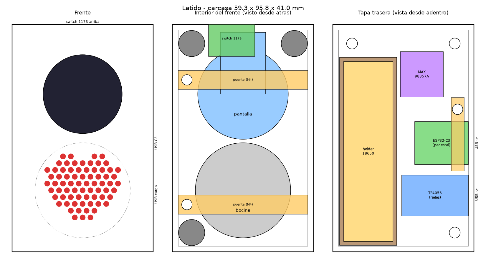
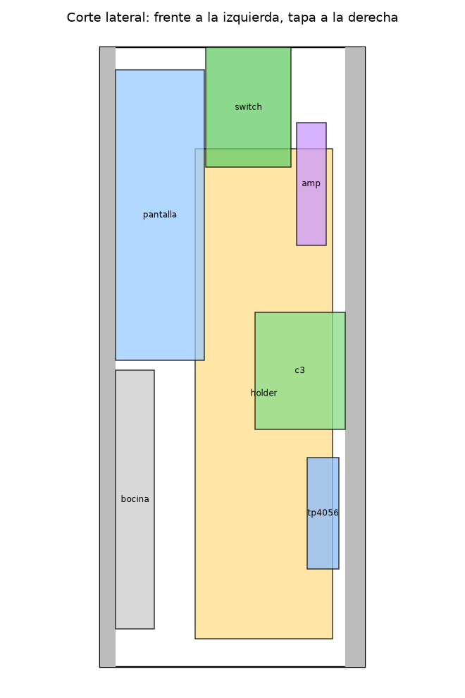

# Latido — el ultrasonido en una pantalla redonda, con su sonido

Proyecto de **Tostatronic** — Ing. Jorge Alvarado.

Un aparatito de 59 × 96 × 41 mm que reproduce en bucle el video del ultrasonido en una
pantalla redonda, con el sonido del corazón del bebé. Funciona con una batería 18650
recargable y el video se sube **desde el celular**, sin cables ni programas: la ESP32
crea su propia red WiFi y sirve una página que recorta y convierte el video ahí mismo.



> **Estado (11 nov 2026):** el firmware compila (ESP32 core 3.3.10, 58 % de la partición)
> pero **todavía no se ha probado en la placa**, y la carcasa **no se ha impreso**.
> Arma primero en protoboard y mide tus piezas antes de imprimir (sección 6).

---

## 1. Materiales

| Pieza | En tostatronic.com |
|---|---|
| ESP32-C3 Super Mini (tipo C) | [BTESP32C3SM](https://www.tostatronic.com/?s=BTESP32C3SM&post_type=product) |
| Pantalla redonda GC9A01 de 1.28" | [BTTFTRLJGC9A01](https://www.tostatronic.com/product/pantalla-tft-lcd-circular-gc9a01-de-1-28-pulgadas/) |
| Amplificador I2S MAX98357A | [BTMAX98357](https://www.tostatronic.com/product/amplificador-i2s-max98357a-3w-esp32/) |
| Bocina 8 Ω 0.5 W de 40 mm | [BTBOC8O2P](https://www.tostatronic.com/product/bocinas-de-8-ohms-2/) |
| Cargador TP4056 tipo C **con protección** | [BTTP4056TC](https://www.tostatronic.com/product/tp4056-tipo-c/) |
| Holder 18650 de 1 pila para soldar | [Porta pilas 18650](https://www.tostatronic.com/product/porta-pilas-holder-para-bateria-18650-en-serie-p-soldar/) |
| Batería 18650 | — |
| Switch balancín On/Off 117S de 15 × 21 mm | [BTSW117S](https://www.tostatronic.com/product/switch-on-off-117s-1521mm-250vac-6a/) |
| 2 resistencias de 100 kΩ (medidor de batería, opcional) | — |
| 6 tornillos **M4 × 16** de cabeza cilíndrica o redonda, con **6 tuercas M4** hexagonales (7 mm entre caras, 3.2 de alto): 3 de la tapa, 2 de los puentes, 1 de la grapa de la ESP32 | — |
| Tornillos **M3 × 6**: 1 a 3 para el holder y 2 para el amplificador | — |

---

## 2. Conexiones

Todos los pines están en [`Latido_Bebe/config.h`](Latido_Bebe/config.h).

| ESP32-C3 Super Mini | Va a | Nota |
|---|---|---|
| GPIO 4 | Pantalla **SCL** | |
| GPIO 6 | Pantalla **SDA** | |
| GPIO 5 | Pantalla **DC** | |
| GPIO 7 | Pantalla **CS** | |
| GPIO 8 | Pantalla **RST** | |
| GPIO 3 | Pantalla **BLK** | brillo; si tu módulo no lo trae, no se cablea |
| 3V3 | Pantalla **VCC** | |
| GPIO 20 | Amplificador **BCLK** | |
| GPIO 21 | Amplificador **LRC** | |
| GPIO 10 | Amplificador **DIN** | |
| GPIO 0 | punto medio del divisor 100 k + 100 k | opcional: `BAT+ —[100k]—●—[100k]— GND` |
| GPIO 1 | botón a GND | opcional (la carcasa no lo lleva) |
| GND | GND de todo | |

`SD` y `GAIN` del amplificador se quedan sin conectar. La bocina va a los dos pads de salida.

### Alimentación

```
18650 (holder) ──> B+ / B−  TP4056  OUT+ ──[ switch ]──┬──> pin 5V de la ESP32-C3
                                    OUT− ──────────────┼──> GND
                                                       └──> Vin del MAX98357A
```

> ### ⚠️ Antes de conectar el USB de la ESP32
>
> El pin **5V** de la Super Mini está unido al USB. Si conectas el USB de la ESP32 con el
> switch encendido, los 5 V del cable llegan directo a la batería, sin pasar por el cargador.
> **Apaga el switch (o saca la pila) siempre que programes la placa.** La batería se carga
> únicamente por el USB del TP4056.

`USB CDC On Boot` tiene que ir en **Enabled**: los GPIO 20 y 21 son el puerto serie de la
placa y aquí llevan el audio.

---

## 3. Cargar el firmware

1. Arduino IDE con el core **esp32 de Espressif ≥ 3.3.0**.
2. Librerías: **GFX Library for Arduino** (moononournation) ≥ 1.6.5 y **JPEGDEC** (bitbank2).
3. Abre `Latido_Bebe/Latido_Bebe.ino` y en *Herramientas*:

| Opción | Valor |
|---|---|
| Placa | ESP32C3 Dev Module |
| USB CDC On Boot | **Enabled** |
| Partition Scheme | No OTA (2MB APP/2MB SPIFFS) |

La partición real sale del `partitions.csv` que va junto al sketch: 1.4 MB de programa y
2.5 MB para el video. Con arduino-cli:

```
arduino-cli compile --fqbn esp32:esp32:esp32c3:CDCOnBoot=cdc,PartitionScheme=no_ota Latido_Bebe
```

---

## 4. Uso

1. Enciende. La pantalla muestra un corazón latiendo con los datos del WiFi.
2. En el celular conéctate a la red **`Latido`**, clave **`corazon123`**
   (se cambian en `config.h`). Se abre sola la página; si no, entra a `http://192.168.4.1`.
3. Elige el video del ultrasonido, arrástralo para centrarlo dentro del círculo y escoge
   dónde empieza y cuánto dura. **Probar el tramo con sonido** te deja oírlo antes.
4. **Convertir y enviar**. El celular lo convierte (240 × 240, a 10, 12 o 15 cuadros por segundo,
   audio a 16 kHz) y lo guarda en la memoria de la ESP32. Empieza a reproducirse en bucle.
5. En la misma página están el **volumen**, el **brillo**, pausar y borrar el video.

Para ahorrar batería el WiFi se apaga solo a los 3 minutos sin nadie conectado. Para
volver a entrar: apaga y prende el switch (o deja presionado 1.5 s el botón, si lo pusiste).

**Cuánto cabe:** unos 2.5 MB, es decir alrededor de 30–40 s con buena calidad. Si pides más,
la página baja la calidad de la imagen para que quepa. Lo ideal es un tramo de 10 a 20 s
que empiece y termine parecido, para que el bucle no se note.

Con el divisor de batería cableado, a 3.2 V el aparato apaga pantalla y audio para cuidar
la celda (el TP4056 con protección la corta además a ~2.5 V).

---

## 5. Carcasa

En [`carcasa/`](carcasa/). Piezas en PLA, sin soportes:

| Archivo | Cuántas | Cómo se imprime |
|---|---|---|
| `Latido_Frente.stl` | 1 | con la cara del frente sobre la cama |
| `Latido_Tapa.stl` | 1 | con la cara de afuera sobre la cama (ya viene volteada) |
| `Latido_Puente.stl` | **2** | acostado, con el bloque del tornillo hacia arriba |
| `Latido_Grapa_C3.stl` | 1 | acostada |



**Frente**

- La pantalla arriba y la bocina abajo, detrás de una rejilla en forma de corazón.
- Cada una se aprieta por atrás con un **puente**: la punta izquierda entra en una bolsa de la
  pared y del lado derecho lleva **un tornillo M4 × 16** con tuerca atrapada en el poste. Se mete primero la punta y luego se
  baja el bloque sobre su poste. Sobre la pantalla el puente deja 1 mm libre: ponle un pedacito
  de cinta de espuma para no presionar los componentes. Centra la pantalla en la ventana antes
  de apretar.
- La bocina entra en su anillo; el puente la mantiene asentada. Un cordón de silicón en la
  orilla sigue siendo buena idea: sella el frente, que es lo que le da cuerpo al sonido.
- **Switch** balancín 117S en la pared de arriba; entra a presión por fuera en un corte de
  19.4 × 13.2 mm.

**Tapa**

- **Holder** parado a la izquierda, dentro de un marco ("casita") que lo abraza con 0.1 mm por
  lado, igual que en la báscula. Lleva tres pilotos M3 (uno al centro y los dos de la ficha):
  usa los que coincidan con tu holder. Las terminales caen en dos canales por donde salen los cables.
- **TP4056** en rieles: se desliza desde la orilla, con el USB hacia afuera, hasta el tope, antes
  de cerrar la caja. Ya cerrada, la pared no lo deja salir. **Suelda sus cables después de
  meterlo** (o por debajo): las bolitas de soldadura de las esquinas no pasan bajo los rieles.
- **ESP32-C3 con los pines soldados**: se sienta en un pedestal que queda entre las dos filas de
  pines (los pines cuelgan a los lados), con tope atrás. Una **grapa** cruza sobre su conector USB:
  una punta entra en un gancho y la otra lleva un M4 × 16 con tuerca atrapada. Los cables van soldados o con Dupont en los pines.
- **MAX98357A** atornillado por sus dos barrenos (M3 × 6) sobre dos postes.
- La tapa cierra con 3 tornillos M4 × 16 que entran en tuercas atrapadas en los postes del frente.
- Los dos USB-C salen por el costado derecho: abajo el de **carga**, arriba el de la ESP32.

### Pausas para las tuercas M4

Las 6 tuercas quedan atrapadas dentro del plástico: hay que pausar la impresión, meterlas
planas hasta el fondo de su hexágono (7.4 mm entre caras, 3.6 de alto) y reanudar. La pausa va
**antes de la primera capa que tapa el hexágono**. Con capas de 0.20 mm, primera capa incluida:

| Pieza | Pausa antes de la capa | Altura | Tuercas |
|---|---|---|---|
| `Latido_Frente.stl` | 32 | 6.2 mm | 2, en los postes de los puentes (pared derecha) |
| `Latido_Frente.stl` | 154 | 30.6 mm | 3, en los postes de la tapa (esquinas) |
| `Latido_Tapa.stl` | 56 | 11.0 mm | 1, en el poste de la grapa de la ESP32 |

Con otro perfil o altura de capa, guíate por la altura y confirma en la vista previa del
laminador que esa capa es la que cierra el hexágono. Sin soportes dentro de los hexágonos.
`validacion_carcasa.json` trae estas mismas alturas.

Todo el interior es la caja acústica de la bocina: quedan unos 106 cm³ de aire. No lo rellenes
y, si quieres un sonido más redondo, pega un poco de guata detrás de la batería.

### Cambiar medidas

`python generar_carcasa.py` (requiere `numpy manifold3d trimesh matplotlib`) vuelve a generar
los STL, las vistas y `validacion_carcasa.json`, que revisa que ninguna pieza choque con otra.
Todas las medidas están al principio del script.

## 6. Mide antes de imprimir

El marco del holder 18650 (76.0 × 20.8 mm), la tarjeta del TP4056 (27.9 × 17.2 mm) y el corte
del switch 117S salen de la carcasa de la báscula, donde ya se probaron impresos. Bocina,
amplificador y ESP32 salen de las fichas de tostatronic.com. Estas otras son las típicas del
módulo y **hay que confirmarlas con vernier**:

| Medida | Valor usado | En el script |
|---|---|---|
| Barrenos del amplificador | 12.6 mm entre centros, a 2.7 mm de la orilla; que pase un M3 | `AMP_BARRENOS` |
| Lo que cuelgan los pines de la ESP32-C3 | 9.2 mm bajo la tarjeta | `C3_PINES` |
| Alto del holder 18650 | 21.3 mm | `HOLDER` |
| Tarjeta redonda de la pantalla | hasta Ø 38 mm | `LCD_PCB_D` |
| Grueso de la pantalla (vidrio + tarjeta) | 5.2 mm | `LCD_GRUESO` |
| Pestaña de los pines de la pantalla | 19 mm de ancho, sube 26 mm desde el centro | `LCD_OREJA` |

Si la imagen sale girada en la carcasa, cambia `TFT_ROTACION` en `config.h`.

---

**Desarrollado por Tostatronic** — Ing. Jorge Alvarado
[tostatronic.com](https://www.tostatronic.com) · Guadalajara, Jalisco
